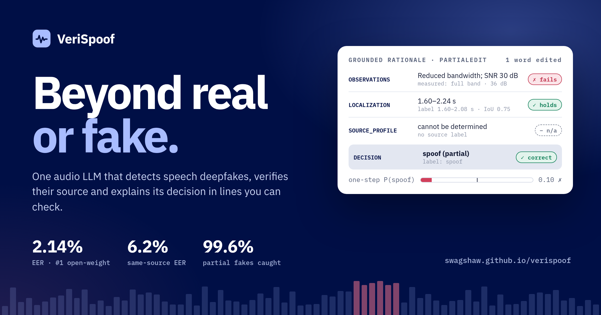
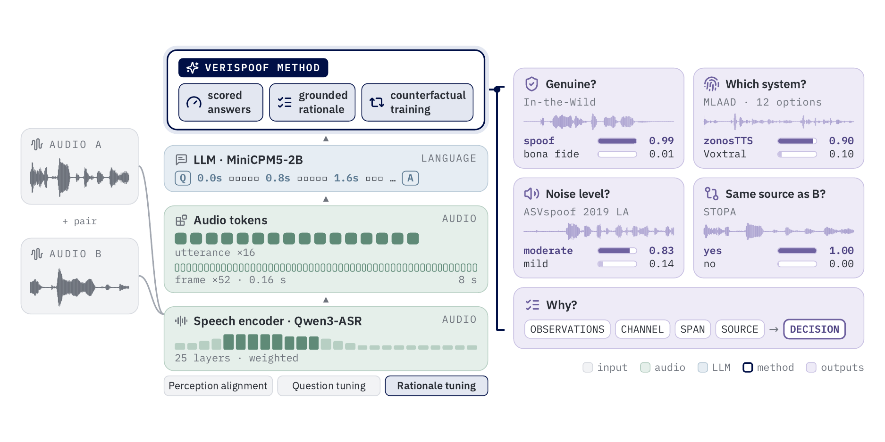

<div align="center">

<a href="https://swagshaw.github.io/verispoof/"></a>

# VeriSpoof

**Beyond real or fake.** One audio LLM for speech deepfake detection, source verification and grounded reasoning.

[](https://swagshaw.github.io/verispoof/)
[](https://huggingface.co/spaces/Speech-Arena-2025/Speech-DF-Arena)
[](tech_report.pdf)
[](https://huggingface.co/AustinXiao/VeriSpoof-Plus)
[](https://huggingface.co/AustinXiao/VeriSpoof-Base)
[](https://huggingface.co/spaces/AustinXiao/VeriSpoof-demo)
[](https://huggingface.co/datasets/AustinXiao/VeriSpoof-Bench)
[](https://creativecommons.org/licenses/by-nc/4.0/)

**[▶ See it reason on real recordings](https://swagshaw.github.io/verispoof/#examples)** · **[Get the model](https://huggingface.co/AustinXiao/VeriSpoof-Plus)** · **[Read the tech report](tech_report.pdf)**

</div>

---

A deepfake detector says how likely a recording is synthetic. A forensic analyst also needs to know which system made
it, whether two recordings share a source, and what the conclusion rests on. **VeriSpoof** answers all of these with
one set of weights: every answer is a sentence whose likelihood is the score, so detection and source verification need
no extra heads, and every explanation is a set of short lines (measured observations, channel, a localized synthetic
span, a source profile, a decision) that can each be checked against the audio, the dataset labels or the generator
metadata. On the 14 Speech-DF-Arena test sets, **VeriSpoof-Plus reaches 2.14% pooled EER, third of 28 systems and first
among open-weight ones**; with the same weights it decides whether two recordings from unseen generators share a source
at **6.2% EER**, and its rationales catch partial fakes that a one-step answer misses (**99.6 vs 78.4%** on PartialEdit).
Only 29.7 M of its 2.85 B parameters are trained.



- **The detection score is the model's own answer.** There is no detection head: the score is the log-likelihood of
  the spoof answer minus that of the bona fide answer to "Is this recording genuine human speech or spoofed speech?".
- **Grounded rationales.** Rationale targets are computed from the audio the model hears (bandwidth, SNR, level and
  clipping measured on the waveform; synthesized spans from dataset labels), so every line can be checked.
- **Faithfulness by counterfactual training.** The decision follows the stated localization: edit the localization
  and the decision changes; edit the channel or observation lines and it does not.
- **Small to train.** Only 29.7 M of the 2.85 B parameters are trained (audio tokenizer, encoder DoRA, LLM LoRA,
  per-token head). The Base recipe takes about 14 GPU-hours on one 48 GB GPU.

This repository holds the **inference package** (`verispoof`), the [project page](https://swagshaw.github.io/verispoof/)
(`docs/`) and the [technical report](tech_report.pdf). Training code is released in stages:

| Component | Status |
|---|---|
| Inference package: detection, grounded rationales with the per-token profile, source verification, closed questions, vLLM backend | ✅ released (this repository) |
| Model weights: [VeriSpoof-Plus](https://huggingface.co/AustinXiao/VeriSpoof-Plus), [VeriSpoof-Base](https://huggingface.co/AustinXiao/VeriSpoof-Base) | ✅ released |
| Interactive demo: [Hugging Face Space](https://huggingface.co/spaces/AustinXiao/VeriSpoof-demo) | ✅ released |
| Evaluation suite: [VeriSpoof-Bench](https://huggingface.co/datasets/AustinXiao/VeriSpoof-Bench) (lists, labels, audio regeneration, scoring, reference outputs) | ✅ released |
| Training code (three-stage recipe, question and rationale construction, counterfactual examples), data pipeline and configs | ⏳ with the peer-reviewed version of the paper |

Star or watch the repository to be notified.

## Results

**[Speech-DF-Arena](https://huggingface.co/spaces/Speech-Arena-2025/Speech-DF-Arena), 14 test sets, EER (%).** Every
line of the official protocols is scored. Inserted into the public snapshot of 31 Oct 2026, VeriSpoof-Plus ranks
**third of 28 systems and first among open-weight ones**; VeriSpoof-Base has less than half the pooled EER of the next
open-weight detector (DF-Arena-1B, 9.52).

| Model | ITW | LA19 | LA21 | DF21 | ASV5 | FoR | Codec | A22T1 | A22T3 | A23R1 | A23R2 | DFADD | LSV | SONAR | **Mean** | **Pooled** |
|---|---|---|---|---|---|---|---|---|---|---|---|---|---|---|---|---|
| VeriSpoof-Plus | 1.90 | 0.22 | 3.44 | 1.24 | 3.40 | 0.09 | 0.12 | 8.65 | 1.18 | 0.50 | 2.41 | 0.00 | 0.02 | 1.92 | **1.79** | **2.14** |
| VeriSpoof-Base | 1.20 | 0.49 | 5.48 | 0.97 | 2.59 | 5.39 | 4.97 | 14.05 | 3.87 | 5.01 | 10.61 | 0.00 | 0.02 | 5.19 | 4.28 | 4.43 |

**SpoofRadar v1.0, 16 test sets.** Plus: pooled EER 4.04, accuracy 95.96, macro-F1 94.54, average EER 1.65.
Base: 4.23 / 95.77 / 94.29 / 3.76. The best open-weight system on that board (DF Arena 500M) has a pooled EER of 9.96.

**Beyond detection** (our protocol, [VeriSpoof-Bench](https://huggingface.co/datasets/AustinXiao/VeriSpoof-Bench)):

| Task | Base | Plus |
|---|---|---|
| Same-generator verification EER, MLAAD seen / unseen model / unseen architecture | 17.23 / 13.80 / 20.25 | 7.68 / 6.17 / 15.00 |
| Same-generator verification EER, SpoofCeleb / STOPA / ASVspoof 2019 LA / ASVspoof 5 | 11.25 / 20.88 / 8.22 / 23.27 | 12.20 / 13.55 / 7.62 / 20.65 |
| Generator identification accuracy, MLAAD seen (closed set) | 95.4 | 96.8 |
| Acoustic model under an unseen vocoder, SpoofCeleb (accuracy) | 84.7 | 69.8 |
| Recording condition (noise / reverberation / codec, accuracy) | 75.9 | 81.3 |
| Source-verification rationale, verdict EER: SpoofCeleb / STOPA / CoSG / LA19 conditions | 20.20 / 13.65 / 21.60 / 29.65 | 18.40 / 14.35 / 21.80 / 24.55 |
| Source-verification rationale, accuracy on REVERSAL pairs | 0.42 | 0.75 |

Rationales catch partial fakes that the one-step answer misses (PartialEdit: 99.6% vs 78.4% for Base), the decision
follows an edited localization worded as never seen in training in 99.5% of tests, and the reasoning decision of Plus
is 89.2–99.6% accurate on nine sets. Full tables: [tech report](tech_report.pdf).

## Installation

Python 3.10+ (tested with 3.12) and a CUDA GPU with bf16 support (Ampere or newer).

```bash
pip install "git+https://github.com/swagshaw/verispoof"           # inference
pip install "verispoof[vllm] @ git+https://github.com/swagshaw/verispoof"   # + vLLM backend for many rationales
```

The weights are downloaded from Hugging Face on first use.

## Quickstart

```python
from verispoof import VeriSpoof

model = VeriSpoof.from_pretrained("AustinXiao/VeriSpoof-Plus")   # or "AustinXiao/VeriSpoof-Base", or a local folder

model.detect("sample.wav")                 # {'label': 'spoof' | 'bonafide', 'score': log p(spoof) - log p(bona fide)}
model.detect(["a.wav", "b.flac"], batch_size=16)
r = model.explain("sample.wav")            # grounded rationale
print(r["text"])                           # OBSERVATIONS / CHANNEL_STATUS / LOCALIZATION / SOURCE_PROFILE / DECISION
r["decision"], r["spans"], r["token_prob"] # per-token probability that each 0.16 s token is synthesized
model.same_source("a.wav", "b.wav", level="generator")  # also "acoustic_model", "vocoder"
model.compare("a.wav", "b.wav")            # source-verification rationale
model.condition("sample.wav", attr="codec")             # also "noise", "reverb"
model.generator("sample.wav", ["XTTS-v2", "Bark", "VITS"])
```

About 6–7 GB of GPU memory for single recordings (all 2.85 B parameters in bf16), about 12 GB for batched detection.
The label uses threshold 0 on the score; on a new language or domain, set the threshold on genuine speech of that
domain (see the model cards). For many rationales, `verispoof.vllm_backend.VeriSpoofVLLM` generates them with vLLM
(up to 46x faster on an A100):

```python
from verispoof.vllm_backend import VeriSpoofVLLM

if __name__ == "__main__":          # vLLM starts its engine in a separate process
    m = VeriSpoofVLLM.from_pretrained("AustinXiao/VeriSpoof-Plus")
    results = m.explain(["a.wav", "b.wav", "c.wav"])
    pairs = m.compare([("a.wav", "b.wav"), ("c.wav", "d.wav")])
```

## Evaluation

[VeriSpoof-Bench](https://huggingface.co/datasets/AustinXiao/VeriSpoof-Bench) holds the item lists, labels, candidate
answers and realization parameters of every result in the report beyond Speech-DF-Arena and SpoofRadar (54 subsets,
177,852 items), the per-item outputs of both models, and the scripts to rebuild the audio from the original corpora,
run a released model and score any model:

```bash
hf download AustinXiao/VeriSpoof-Bench --repo-type dataset --local-dir VeriSpoof-Bench && cd VeriSpoof-Bench
python scripts/prepare_audio.py --roots LA19=/corpora/ASVspoof2019 ... \
    --musan /corpora/musan --rirs /corpora/RIRS_NOISES --out bench_audio
python scripts/run_verispoof.py --model AustinXiao/VeriSpoof-Plus --manifest bench_audio/manifest.csv --out preds/plus
python scripts/score.py --pred preds/plus --out preds/plus/metrics.json
```

Detection on Speech-DF-Arena and SpoofRadar uses their official protocols; the score of each recording is
`model.detect(...)["score"]` (higher = more likely spoof).

## Citation

```bibtex
@techreport{verispoof2026,
  title       = {{VeriSpoof}: Beyond Real or Fake with One Audio {LLM} for Speech Deepfake Detection, Source Verification, and Grounded Reasoning},
  author      = {Xiao, Yang},
  institution = {The University of Melbourne},
  type        = {Technical Report},
  year        = {2026},
  url         = {https://github.com/swagshaw/verispoof/blob/main/tech_report.pdf}
}
```

## License

Code and model weights: [CC BY-NC 4.0](LICENSE) (non-commercial use). The released models contain modified versions of
[MiniCPM5-2B](https://huggingface.co/openbmb/MiniCPM5-2B) (OpenBMB) and of the
[Qwen3-ASR-1.7B](https://huggingface.co/Qwen/Qwen3-ASR-1.7B) audio encoder (Alibaba Cloud), both Apache-2.0, which
keep their licence (see [NOTICE](NOTICE)). Each corpus keeps its own terms; MLAAD, ReplayDF, ADD and Codecfake are
non-commercial, LibriSeVoc and WaveFake share-alike.

VeriSpoof is a research tool for audio deepfake detection, source tracing and explainable forensics. It should not be
the only basis for decisions about people; combine its output with other evidence and human review.

## Contact

Yang Xiao, The University of Melbourne, yxiao9550@student.unimelb.edu.au
